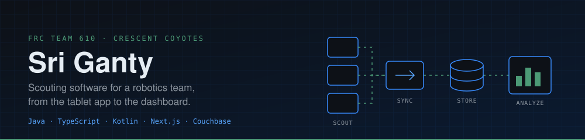
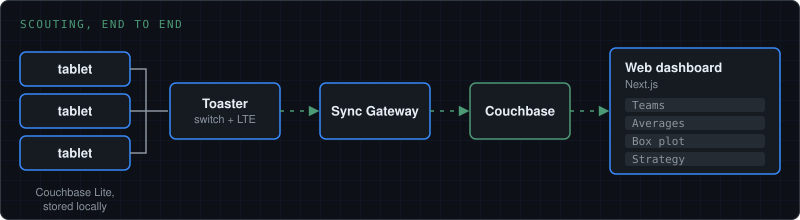
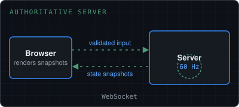
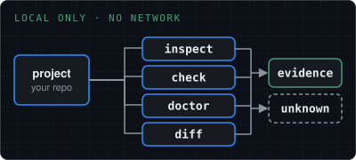
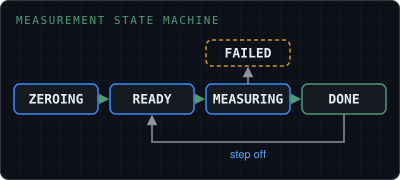
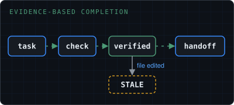

  

Student developer on FRC Team 610, mostly writing Java and TypeScript. I build scouting software, a match simulator, and command-line tools.

[**Portfolio**](https://siriwastaken.github.io) · [Repositories](https://github.com/SiriWastaken?tab=repositories) · [DMOJ](https://dmoj.ca/user/SiriWastaken)

## Projects

<table>
<tr>
<td colspan="2" valign="top">
 
<b>610 Scouting</b> &nbsp;private repos · active 
The Android app and web dashboard Team 610 uses to scout events. Match data is stored locally in Couchbase Lite, synced to Couchbase, and analyzed as team averages, box plots and strategy views. 
One annotated <code>DataClass.kt</code> declares every scouted field, and the screens, saved documents and resets follow from it. The web side enforces five roles on the server and ships with unit, security, contract and e2e suites. 
<code>Kotlin</code> <code>Jetpack Compose</code> <code>Java</code> <code>Couchbase</code> <code>Next.js</code> <code>TypeScript</code>
</td>
</tr>
<tr>
<td width="50%" valign="top">
 
<a href="https://github.com/SiriWastaken/610-Match-Sim"><b>610 Match Sim</b></a> &nbsp;active 
A browser FRC match simulator. The server is authoritative: a fixed 60 Hz tick owns movement, game pieces and match state, and clients only send validated input. 
<code>TypeScript</code> <code>Next.js</code> <code>WebSockets</code>
</td>
<td width="50%" valign="top">
 
<a href="https://github.com/SiriWastaken/sift"><b>SIFT</b></a> &nbsp;in progress 
A local-first CLI that tells you what a project is, whether it looks healthy, and what changed. No network or accounts, and anything it can't back with evidence is reported as <code>unknown</code> instead of guessed. 
<code>Java 17</code> <code>Maven</code>
</td>
</tr>
<tr>
<td width="50%" valign="top">
 
<a href="https://github.com/SiriWastaken/Wii-Fit-Board"><b>Wii-Fit-Board</b></a> &nbsp;experiment 
Turns a Wii Balance Board into a Bluetooth scale, with factory calibration, tare with drift tracking and a weighing state machine. Hardware validation is still pending. 
<code>Java</code> <code>HID</code>
</td>
<td width="50%" valign="top">
 
<a href="https://github.com/SiriWastaken/Claudeium"><b>Claudeium</b></a> &nbsp;active 
A verification layer for AI coding agents. A task counts as verified only after a recorded passing check, and later edits to the file mark that evidence stale. 
<code>Node.js</code> <code>Claude Code plugin</code>
</td>
</tr>
</table>

Also: **610 Design App** (private; a mobile-first PWA for logging prototype tests with photos and video, on Next.js and Couchbase), [claude-needs-input](https://github.com/SiriWastaken/claude-needs-input) (a Claude Code plugin that flags when the agent is waiting on you), [Contradictions](https://github.com/SiriWastaken/Contradictions) (a Roblox logic game in Luau), and the [portfolio site](https://github.com/SiriWastaken/siriwastaken.github.io) itself.

## Stack

<table>
<tr>
<td width="50%" valign="top">
<b>LANGUAGES</b> 

 
Java and TypeScript most.
</td>
<td width="50%" valign="top">
<b>APPLICATIONS</b> 
 
Jetpack Compose for Android; React Native in the previous scouting app.
</td>
</tr>
<tr>
<td valign="top">
<b>BACKEND AND DATA</b> 
 
Couchbase (server and Lite), WebSockets, Auth.js.
</td>
<td valign="top">
<b>TOOLING</b> 
 
Playwright for e2e tests.
</td>
</tr>
</table>

## On GitHub

  
  

  <a href="https://siriwastaken.github.io">Portfolio</a> &nbsp;·&nbsp;
  <a href="https://github.com/SiriWastaken?tab=repositories">Repositories</a> &nbsp;·&nbsp;
  <a href="https://dmoj.ca/user/SiriWastaken">DMOJ</a>

