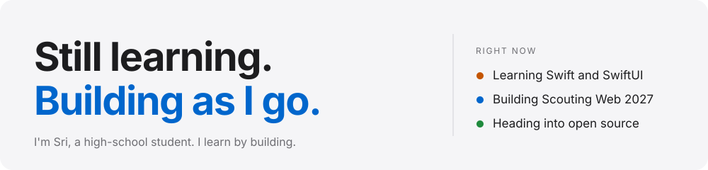
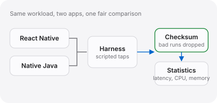
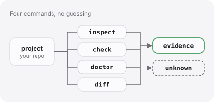
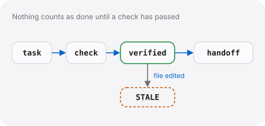
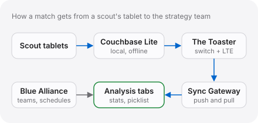
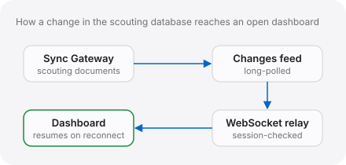
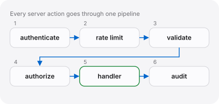

<picture><source media="(prefers-color-scheme: dark)" srcset="./assets/header-dark.svg"></picture>

I like software that has to cope with messy conditions: tablets syncing through a network box we built ourselves, or a benchmark that has to back up its own numbers. I started with Java and now mostly write TypeScript.

[**Portfolio**](https://siriwastaken.github.io) · [Repositories](https://github.com/SiriWastaken?tab=repositories) · [DMOJ](https://dmoj.ca/user/SiriWastaken)

## Work

<table>
<tr>
<td width="50%" valign="top">
<a href="https://github.com/SiriWastaken/reactN-vs-Java-android-testbench"><picture><source media="(prefers-color-scheme: dark)" srcset="./assets/benchmark-dark.svg"></picture></a> 
<a href="https://github.com/SiriWastaken/reactN-vs-Java-android-testbench"><b>Scouting App Benchmark</b></a> &nbsp;completed 
I ran our scouting app against a native Java version on the actual tablet to decide whether a rewrite was worth it. Native Java was faster on taps (32 vs 75 ms median) and used far less CPU and memory; React Native had smoother frames under load. One tablet, three runs per cell. 
<code>React Native</code> <code>Java</code> <code>Android</code> <code>Python</code>
</td>
<td width="50%" valign="top">
<a href="https://github.com/SiriWastaken/sift"><picture><source media="(prefers-color-scheme: dark)" srcset="./assets/sift-dark.svg"></picture></a> 
<a href="https://github.com/SiriWastaken/sift"><b>SIFT</b></a> &nbsp;in development 
A command-line tool that inspects, health-checks and diffs the project you're in, and says <code>unknown</code> instead of guessing. It only runs commands it knows are right for the detected Maven, Gradle, Node or Python project, and never goes through a shell. 
<code>Java</code> <code>Maven</code> <code>JUnit</code>
</td>
</tr>
<tr>
<td width="50%" valign="top">
<a href="https://github.com/SiriWastaken/Claudeium"><picture><source media="(prefers-color-scheme: dark)" srcset="./assets/claudeium-dark.svg"></picture></a> 
<a href="https://github.com/SiriWastaken/Claudeium"><b>Claudeium</b></a> &nbsp;in development 
A task ledger for AI-assisted coding where nothing counts as done until a check has passed against the files it covers. Evidence is tied to a fingerprint of those files, so later edits mark it <code>STALE</code>. 
<code>JavaScript</code> <code>Node.js</code> <code>Claude Code plugin</code>
</td>
<td width="50%" valign="top">
<picture><source media="(prefers-color-scheme: dark)" srcset="./assets/scouting-2026-dark.svg"></picture> 
<b>Scouting App 2026</b> &nbsp;completed · private repo 
The Android app our six scouts use to record every robot in a match. It works offline and syncs across the team's tablets. A match predictor built on the synced data picked the winning alliance 84.7% of the time at the 2026 Ontario Provincial Championships (Technology Division). 
<code>TypeScript</code> <code>React Native</code> <code>Expo</code> <code>Couchbase Lite</code>
</td>
</tr>
<tr>
<td width="50%" valign="top">
<picture><source media="(prefers-color-scheme: dark)" srcset="./assets/scouting-web-dark.svg"></picture> 
<b>Scouting Web 2027</b> &nbsp;in development · private repo 
A Next.js dashboard for the same data, with its own sign-in, roles enforced on the server, live updates over WebSockets and an admin panel. Google and Apple sign-in are written directly against OpenID Connect, with no auth library. 
<code>TypeScript</code> <code>Next.js</code> <code>WebSockets</code> <code>Playwright</code>
</td>
<td width="50%" valign="top">
<picture><source media="(prefers-color-scheme: dark)" srcset="./assets/design-app-dark.svg"></picture> 
<b>Design App</b> &nbsp;in development · private repo 
A phone-first web app for logging robot prototype tests with photos and video. Entry drafts autosave offline to IndexedDB, and every server action goes through one authenticate, validate, authorize and audit pipeline. 
<code>TypeScript</code> <code>Next.js</code> <code>Couchbase</code> <code>Auth.js</code> <code>Zod</code>
</td>
</tr>
</table>

More: [Who Wants to Be a Millionaire](https://github.com/SiriWastaken/Who-Wants-To-Be-a-Millionaire) (my ICS3U final, a quiz game in Java Swing with every screen drawn by hand), [610 Match Sim](https://github.com/SiriWastaken/610-Match-Sim) (an FRC match simulator with an authoritative 60 Hz server), [Wii-Fit-Board](https://github.com/SiriWastaken/Wii-Fit-Board) (a Wii Balance Board turned into a Bluetooth scale), [claude-needs-input](https://github.com/SiriWastaken/claude-needs-input) and [Contradictions](https://github.com/SiriWastaken/Contradictions).

## Stack

<table>
<tr>
<td width="50%" valign="top">
<b>LANGUAGES</b> 
<picture><source media="(prefers-color-scheme: dark)" srcset="https://skillicons.dev/icons?i=java&theme=dark"></picture>
<picture><source media="(prefers-color-scheme: dark)" srcset="https://skillicons.dev/icons?i=ts&theme=dark"></picture> 
Java and TypeScript most. Learning Swift and SwiftUI; C# just starting.
</td>
<td width="50%" valign="top">
<b>FRONTEND</b> 
<picture><source media="(prefers-color-scheme: dark)" srcset="https://skillicons.dev/icons?i=react&theme=dark"></picture>
<picture><source media="(prefers-color-scheme: dark)" srcset="https://skillicons.dev/icons?i=nextjs&theme=dark"></picture> 
React Native for the 2026 scouting app, Next.js for the web.
</td>
</tr>
<tr>
<td valign="top">
<b>TOOLS AND PLATFORM</b> 
<picture><source media="(prefers-color-scheme: dark)" srcset="https://skillicons.dev/icons?i=git&theme=dark"></picture>
<picture><source media="(prefers-color-scheme: dark)" srcset="https://skillicons.dev/icons?i=github&theme=dark"></picture>
<picture><source media="(prefers-color-scheme: dark)" srcset="https://skillicons.dev/icons?i=vercel&theme=dark"></picture> 
Claude Code as my day-to-day coding assistant.
</td>
<td valign="top">
<b>LIBRARIES AND DATA</b> 
<picture><source media="(prefers-color-scheme: dark)" srcset="https://skillicons.dev/icons?i=tailwind&theme=dark"></picture> 
Couchbase Lite and Sync Gateway, Expo, NativeWind, Playwright.
</td>
</tr>
</table>

## On GitHub

<picture><source media="(prefers-color-scheme: dark)" srcset="https://github-readme-stats.vercel.app/api?username=SiriWastaken&show_icons=true&hide_border=true&disable_animations=true&bg_color=1c1c1e&title_color=2997ff&text_color=a1a1a6&icon_color=2997ff"></picture>
<picture><source media="(prefers-color-scheme: dark)" srcset="https://github-readme-stats.vercel.app/api/top-langs/?username=SiriWastaken&layout=compact&langs_count=6&hide_border=true&disable_animations=true&bg_color=1c1c1e&title_color=2997ff&text_color=a1a1a6&icon_color=2997ff"></picture>

The language bars count bytes of code in public repos. They say nothing about skill.
